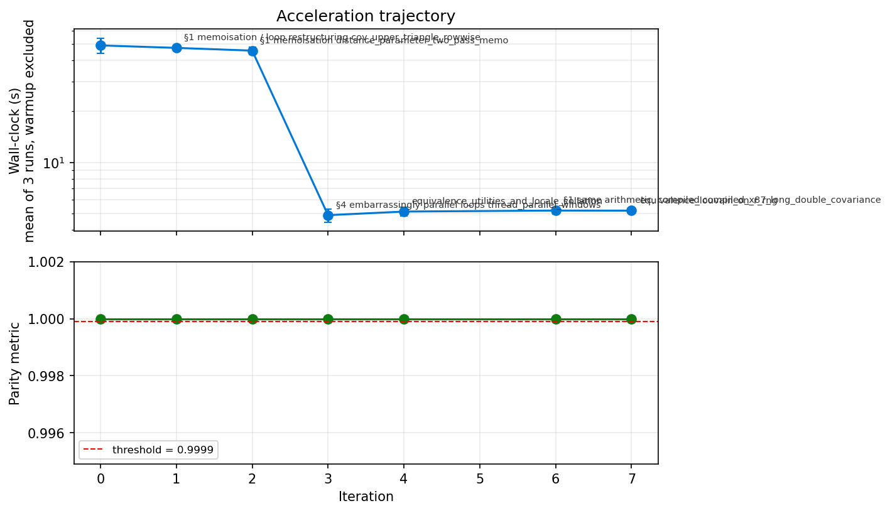

# Reconstruction Report — Cicero → `epione.tl`

Port of the R package **cicero** for Monocle 3 into epione, following the omicverse-rebuildr protocol
(R source as the specification, gates pre-registered in [`manifest.yaml`](manifest.yaml) /
[`MANIFEST.md`](MANIFEST.md) before any Python, exact rewrites only). Branch `feat/cicero-port`.

## 1. Identity

| Field | Value |
|---|---|
| Python location | `epione.tl` (`_cicero.py`, `_glasso.py`, `_louvain_r.py`) — inside epione, no separate wheel |
| Upstream R package | cicero **1.3.9** (Monocle 3 branch), cole-trapnell-lab/cicero-release@495ef0d |
| Reference stack | R 4.3.3, monocle3 1.3.1, glasso 1.11, FNN 1.1.4.1, igraph 2.1.4 (conda, `envs/recreate_envs.sh`) |
| Algorithm class | multi-output: deterministic (aggregation, distance parameter, glasso, coaccess, gene activity), ordinal / ranked views of coaccess, clustering (CCANs) |
| Parity thresholds (pre-registered) | coaccess max abs err ≤ 1e-8; Pearson/Spearman ≥ 0.9999; Jaccard(> 0.25) ≥ 0.999; distance parameter rel. err ≤ 1e-6; CCAN ARI ≥ 0.95; exact equality for RNG draws, rows, NA pattern, format, utilities |
| Final parity | **all 24 pre-registered gates pass** (F1, F2); coaccess max abs err 8.0e-16 (F1) / 4.4e-16 (F2) in R's row order; identical bins, windows, mean distance parameter and CCAN tables |
| Audit class | **C** — exact re-implementation plus exact accelerations (threads; compiled x87 long double) and two cross-language emulations (R RNG + igraph Louvain, R's `round`) |
| LOC (Python, excl. tests) | 2,338 (`_cicero.py` 1,629, `_glasso.py` 359, `_louvain_r.py` 350); R: 2,888 (`R/*.R`) + 466 (`glasso.f`) |
| Speed-up vs R (`make_cicero_cds` + `run_cicero`) | F2: 12.8× (1 thread), 94× (8 threads); F3 genome: > 19× / > 65× (lower bounds: R had not finished after 4 h) |

## 2. R function coverage audit

From `engine.r_function_audit` ([`AUDIT.md`](AUDIT.md)), hand-reviewed in [`port.yaml`](port.yaml).

### 2.1 Exported R functions (NAMESPACE)

| R function | Python | Status | Tests / gates | Notes |
|---|---|---|---|---|
| `make_cicero_cds` | `epi.tl.make_cicero_cds` | ✅ | gates 1–3; `test_make_cicero_cds_*` | `random_state`/`rng`/`chosen`/`layer` added |
| `estimate_distance_parameter` | `epi.tl.estimate_distance_parameter` | ✅ | gates 5–6 | no hg19 default for `genomic_coords` |
| `generate_cicero_models` | `epi.tl.generate_cicero_models` | ✅ | gates 4, 7 | `n_jobs` |
| `assemble_connections` | `epi.tl.assemble_connections` | ✅ | gates 8–12 | R's row order |
| `run_cicero` | `epi.tl.run_cicero` | ✅ | gates 8–13 | |
| `generate_ccans` | `epi.tl.generate_ccans` | ✅ | gates 16–17 | `rng="R"` exact, `rng="igraph"` fast |
| `find_overlapping_ccans` | `epi.tl.find_overlapping_ccans` | ✅ | informational (identical table) | |
| `annotate_cds_by_site` | `epi.tl.annotate_cds_by_site` | ⚠️ partial | gate 14 (gene column) | `maxgap = "nearest"` not ported |
| `build_gene_activity_matrix` | `epi.tl.build_gene_activity_matrix` | ✅ | gate 14 | cells × genes (R: transposed) |
| `normalize_gene_activities` | `epi.tl.normalize_gene_activities` | ✅ | gate 15 | |
| `make_atac_cds` | `epi.tl.make_atac_cds` | ✅ | gate 19 | |
| `aggregate_nearby_peaks` | `epi.tl.aggregate_nearby_peaks` | ✅ | gate 20 | |
| `aggregate_by_cell_bin` | `epi.tl.aggregate_by_cell_bin` | ✅ | gate 21 | |
| `compare_connections` | `epi.tl.compare_connections` | ✅ | gate 22 | |
| `find_overlapping_coordinates` | `epi.tl.find_overlapping_coordinates` | ✅ | gate 23 | NA → `None` |
| `df_for_coords` | `epi.tl.df_for_coords` | ✅ | gate 24 | |
| `ranges_for_coords` | — | ⛔ skipped | — | returns a Bioconductor `GRanges`; `df_for_coords` covers it |
| `plot_connections` | — | ⛔ skipped | — | Gviz plotting; epione has `pl.plot_browser_track`, `pl.igv_browser` |
| `plot_accessibility_in_pseudotime` | — | ⛔ skipped | — | ggplot2 plotting |
| `glasso::glasso` (dependency) | `epi.tl.glasso` | ⚠️ partial | gate 4 | cold start, exact path; `nobs`, `zero`, `approx`, warm start, `trace` not ported |

**Coverage: 16 / 19 exports ported (84 %; all 16 non-plotting, non-GRanges exports), 100 % of the
pipeline path.** Plus `cicero_connections_to_celloracle` (new: CellOracle input).

### 2.2 Internal helpers

`generate_windows`, `get_genomic_range`, `calc_dist_matrix`, `get_rho_mat`, `find_distance_parameter`,
`reconcile`, `make_ccan_graph`, `make_sparse_matrix`, `number_of_ccans`, `find_ccan_cutoff`,
`split_peak_names`, `make_bin_col`, `sparse_to_datatable`, `agg_cells`,
`build_composite_gene_activity_matrix` are ported (inlined or `_`-prefixed); monocle3's
`detect_genes`, `estimate_size_factors` (`estimate_sf_sparse`), `new_cell_data_set` side effects;
R's `mean`, `cov`, `cov2cor`, `round`, `sample` and locale `sort`; glasso.f's `connect`, `row`,
`lasinv1`, `setup`, `lasso`, `fatmul`, `inv`; igraph's multilevel, `qsort`, RNG bridge. Plot helpers
(`make_gene_model_track`, `plotBedpe`, …) are not ported.

### 2.3 Ecosystem reuse

[`DISCOVERY.md`](DISCOVERY.md): no omicverse port of cicero, glasso, FNN or igraph exists. Reused from
epione itself: `epione.tl._rrng.RRandom` (bit-exact R Mersenne-Twister + rejection sampling, written for
the ArchR/harmony ports). `py-Monocle3` exists but was not needed (5 lines of monocle3 are used).
Replacements: `scipy.spatial.cKDTree` for `FNN::knn.index`, numpy/pandas for data.table/GenomicRanges.

## 3. Parity evidence

### 3.1 Per-output gates (thresholds read-only; values from `parity_check.py`, `parity_utils.py`)

| # | Output | Threshold | F1 (`cicero_data`) | F2 (E8.5 heart chr19) | Pass |
|---|---|---|---|---|---|
| 1 | bins + sampled windows (rrng) | exact | 25 bins, 115 windows identical | 3,235 bins, 110 windows identical | ✅ |
| 2 | kNN sets | exact | 0 / 200 differ | 0 / 16,787 differ | ✅ |
| 3 | aggregated matrix, size factors | 1e-8 | 0 / 0 | 0 / 0 | ✅ |
| 4 | glasso `w`, `wi`, zero pattern (44 windows each) | 1e-8; exact | 2.7e-15, 5.4e-9 (on \|wi\| ≤ 5e3); 0 | 4.4e-15, 1.0e-15; 0 | ✅ |
| 5 | distance parameter per window (injected) | 1e-6 rel | 2.6e-15 | 1.3e-15 | ✅ |
| 6 | mean distance parameter | 1e-6 rel | 0 (0.6404942304943019) | 0 (0.4013476662018633) | ✅ |
| 7 | window status | exact | 283 glasso / 30 skipped, identical | identical | ✅ |
| 8 | (Peak1, Peak2) rows, NA pattern | exact | 543,286 rows, 16,010 NA, same order | 1,240,298 rows, 31,084 NA, same order | ✅ |
| 9 | coaccess max abs err | 1e-8 | 8.0e-16 | 4.4e-16 | ✅ |
| 10 | Pearson / Spearman | 0.9999 | 1 − 1e-14 / 1 − 2e-12 | 1.0 / 1 − 2e-13 | ✅ |
| 11 | Jaccard(coaccess > 0.25) | 0.999 | 1.0 (20,610 pairs) | 1.0 (10,162 pairs) | ✅ |
| 12 | coaccess, R draws injected | 1e-8 | 8.0e-16 | 4.4e-16 | ✅ |
| 13 | CellOracle format | exact | ✅ | ✅ | ✅ |
| 14 | `build_gene_activity_matrix` (+ annotation) | 1e-8 | 8.9e-16 (602 genes) | — | ✅ |
| 15 | `normalize_gene_activities` | 1e-8 rel | 6.7e-16 | — | ✅ |
| 16 | CCAN ARI vs R (seed 42, R's cutoff) | 0.95 | **1.0** (identical tables, 5 seeds) | **1.0** (identical tables, 5 seeds) | ✅ |
| 17 | CCAN cutoff | 0.02 | 0.46 = R | 0.27 = R | ✅ |
| 18 | coaccess with `rng="numpy"` (distributional) | ≥ median R-vs-R − 0.02 | — | Pearson 0.9913 (≥ 0.9716), Jaccard 0.858 (≥ 0.848); R-vs-R 0.989–0.993 / 0.833–0.871 | ✅ |
| 19–24 | `make_atac_cds`, `aggregate_nearby_peaks`, `aggregate_by_cell_bin`, `compare_connections`, `find_overlapping_coordinates`, `df_for_coords` | exact / 1e-8 | identical (21: 0 / 1.1e-16) | — | ✅ |

Gate 16 history: with python-igraph's Louvain (iterations 0–6) F1 gave ARI 0.935 against R's seed-42
run — **below the pre-registered 0.95** (R's own seeds agree with each other at median 0.964, min 0.935)
— while F2 gave 0.995. Iteration 7 replaced it by an exact port of igraph's Louvain on R's random
stream (and R's `round`), after which both fixtures reproduce R's CCAN table for every seed tested.
The threshold was not changed.

### 3.2 Per-fixture wall-clock (same node, shared allocation; R single-threaded as Cicero runs it)

| Fixture | Size | R `make_cicero_cds` + `run_cicero` | Python, 1 thread | Python, 8 threads |
|---|---|---|---|---|
| F1 `cicero_data` | 200 cells × 6,146 peaks | 0.4 s + 117 s | ≈ 20–45 s (noisy) | 5.2 s |
| F2 E8.5 heart chr19 | 16,787 × 8,927 | 166 s + 1,088 s = 20.9 min | 6.0 s + 91.6 s = 1.6 min | 2.3 s + 11.1 s = 13.4 s |
| F3 E8.5 heart genome | 16,787 × 331,372 (10,911 windows) | 328 s + > 4 h (unfinished: `generate_cicero_models` still running after 3 h 46 min; `assemble_connections` not reached) | 72.8 s + 666 s = 12.3 min | 70.3 s + 153 s = 3.7 min |

R step breakdown (F2): `estimate_distance_parameter` 917 s, `generate_cicero_models` 80 s,
`assemble_connections` 91 s; F3: 645 s, > 13,500 s (unfinished), not reached. R subsets the whole 331k-peak × 3,235-bin object for every one of the 10,911 windows, most likely what dominates its genome-wide run; it also received only ~55 % of a core (the allocation was shared with other jobs), so its wall-clock is inflated — but even its CPU time (2 h 13 min so far) is already ~11× the Python single-thread wall-clock. The Python gains come mostly from the
distance-parameter search (numba glasso, each distinct window bisected once) and from
`assemble_connections` (vectorised grouping instead of data.table melt/by).

F3 parity (light mode, no gate pre-registered for F3): pending — the R run had not finished when this report was written (it keeps running in the allocation and writes `ref/F3_seed42`; `cicero_port/scripts/compare_F3.py` then compares the 44,004,472-row tables). What is known: R and Python reached the same mean distance parameter (0.32355466609419303, identical to 17 digits); Python fits 10,102 windows and skips 809.

### 3.3 Reproduce

```bash
bash envs/recreate_envs.sh all                      # in a Slurm job; envs on $L_SCRATCH
Rscript tests/parity/cicero/make_fixture_F1.R fixtures/F1
python  tests/parity/cicero/make_fixture_e85.py <export/e85> <mm10.chrom.sizes> fixtures/F2 chr19
Rscript tests/parity/cicero/r_reference_driver.R fixtures/F1 ref/F1_seed42 42 full 42,2017,7,11,23
Rscript tests/parity/cicero/r_reference_driver.R fixtures/F2 ref/F2_seed42 42 full 42,2017,7,11,23
Rscript tests/parity/cicero/r_utils_driver.R ref/F1_seed42 ref/F1_utils
EPIONE_CICERO_PARITY_DIR=<dir with fixtures/ ref/> pytest -q tests/test_cicero.py   # 23 tests
```

## 4. Acceleration evidence

### 4.1 Two-plot evaluation

 — per-iteration narrative in
[`examples/evolution.ipynb`](examples/evolution.ipynb), log in [`ITERATION_LOG.md`](ITERATION_LOG.md).

### 4.2 Accepted

| Iter | Change | Admissibility | Effect |
|---|---|---|---|
| 0 | baseline translation | — | all deterministic gates pass |
| 1 | covariance: upper triangle, row-wise long-double sums | E (same additions, same order) | 2.7× per 200-site covariance |
| 2 | distance parameter: replay sampling, bisect each distinct window once | E | 1.04× on F1 |
| 3 | threads over windows (`n_jobs`) | E (independent windows, ordered collection) | 10× on F1 (8 threads) |
| 4 | remaining exported utilities; R's locale collation | equivalence | gates 19–24 |
| 6 | compiled x87 (`x86_fp80`) long-double covariance | E (identical instructions) | F2 `run_cicero` 32.6 s → 11.6 s |
| 7 | igraph Louvain on R's RNG; R's `round` | equivalence | gate 16: 0.935 → 1.0 on F1 |

### 4.3 Rejected

| Iter | Change | Reason |
|---|---|---|
| 5 | double-precision BLAS covariance | (B) bounded, not exact (bound in [`MATH.md`](MATH.md)); gates still passed (coaccess err 6.9e-15), 3.7× faster on F2 — rejected under the "provably equivalent only" rule |

## 5. Code quality audit

| Check | Status |
|---|---|
| fresh environment (`envs/recreate_envs.sh`, explicit specs saved) + editable epione | ✅ |
| `pytest -q tests/test_cicero.py` | ✅ 23 / 23 (2 full-size tests need `EPIONE_CICERO_PARITY_DIR`) |
| Notebook 1 [`examples/compare_R_vs_Python.ipynb`](examples/compare_R_vs_Python.ipynb) (6 sections, executed) | ✅ |
| Notebook 2 tutorial [`epione_guide/tutorials/single/t_cicero.ipynb`](../../../epione_guide/tutorials/single/t_cicero.ipynb) (executed) | ✅ |
| Notebook 3 [`examples/function_by_function_R_parity.ipynb`](examples/function_by_function_R_parity.ipynb) (executed) | ✅ |
| Notebook 4 [`examples/evolution.ipynb`](examples/evolution.ipynb) + `evolution.png` (8 iteration blocks) | ✅ |
| R per-function dumps (`r_reference_driver.R` + `r_utils_driver.R`, role of `r_per_function_dump.R`) | ✅ |
| `MATH.md`, `ITERATION_LOG.md`, `DISCOVERY.md`, `AUDIT.md`, `port.yaml` (parses) | ✅ |
| License | cicero MIT (notice in `epione/tl/_licenses/CICERO.LICENSE`); igraph GPL-2.0-or-later (compatible with epione's GPL-3). **glasso is "GPL-2" in its CRAN DESCRIPTION, i.e. version 2 only as written; `_glasso.py` is a line-by-line translation, so its combination with GPL-3 epione needs the maintainers' licence review before release** (SPDX headers and NOTICE entries added) |
| PyPI / separate repo | not applicable (inside epione; nothing pushed) |

## 6. Known limitations

- Fixture-level equivalence: F1 (200 cells, one chromosome) and F2 (16,787 cells, chr19); F3 genome
  run compared once without a pre-registered gate.
- Exactness of the random draws assumes the R session uses the default RNG (`Mersenne-Twister`,
  `Inversion`, `Rejection`), and that `set.seed()` is called where `random_state` is passed. In an R
  script with one `set.seed()` at the top, pass one `RRandom` object along (see tutorial).
- R sorts names with the locale; the port follows `en_US.UTF-8`. A C-locale R session orders gene
  levels, merged-peak names and `aggregate_by_cell_bin` rows differently (values are unaffected).
- The covariance is bit-identical to R only on x86-64 Linux (x87 long double); elsewhere numpy's
  `longdouble` mirrors the platform's R.
- glasso: residual differences ≤ 5e-9 on `wi` entries of 5e3 in nearly singular windows
  (compiled-Fortran association), far below the gates; iteration counts identical.
- With `rng="numpy"` the bins and windows differ from R's; the result is then as close to R as two
  R seeds are to each other (gate 18), not identical.
- Licence: `_glasso.py` translates GPL-2(-only) code into a GPL-3 package — to be cleared before
  publishing (options: confirm "or later" with the glasso authors, or keep the solver as an optional
  separately-licensed module).
- Not ported: plotting (`plot_connections`, `plot_accessibility_in_pseudotime`), `ranges_for_coords`,
  `annotate_cds_by_site(maxgap = "nearest")`, glasso's `approx`/warm start/`zero`/log-likelihood.
- `generate_ccans(rng="R")` runs Louvain in pure Python (≈ 0.2 s per call on 2,000-peak graphs;
  `find_ccan_cutoff` calls it ~15–20 times); use `rng="igraph"` for very large genome-wide graphs.

## 7. Integration into epione

- Code: `epione/tl/_cicero.py`, `_glasso.py`, `_louvain_r.py`; public API in `epione.tl` (see the
  "Cicero" rows of `epione_guide/api/index.md`).
- Tutorial: `epione_guide/tutorials/single/t_cicero.ipynb` (listed in `regulation.md`).
- CellOracle: `epi.tl.cicero_connections_to_celloracle(conns, path)` writes `Peak1, Peak2, coaccess`
  with `chr_start_end` ids; a stage-level driver is `cicero_port/scripts/run_cicero_celloracle.py`.

## 8. Sign-off

| Field | Value |
|---|---|
| Author | Claude (agent) for steorra |
| Date | 2026-11-09 |
| Active time | ≈ 4 h (single session) |
| Iterations | 8 (6 accepted speed/equivalence steps, 1 rejected, baseline) |
